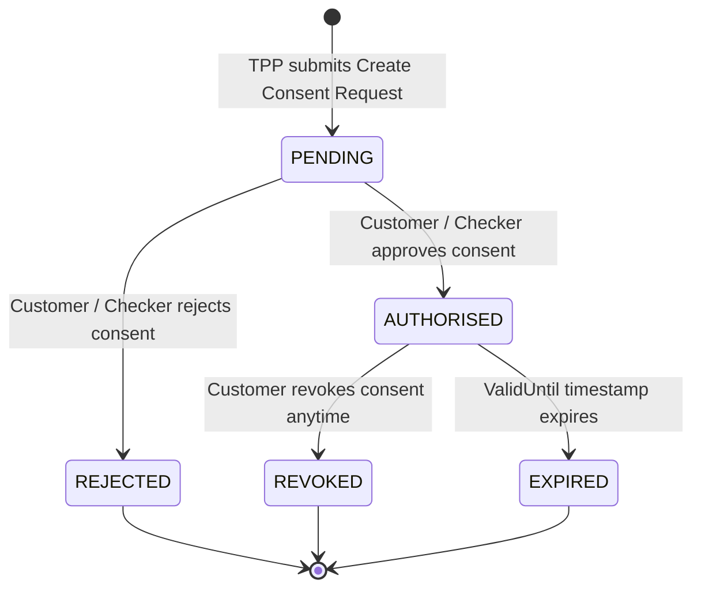

# Open Banking Consent Management & Lifecycle Guide

## What is Open Banking Consent Management?
In modern Open Banking frameworks (UK Open Banking Standard, Berlin Group NextGenPSD2, CDR Australia), a bank **never** shares customer financial data or initiates payments on behalf of a third party without an explicit, time-bounded, and purpose-bound **Consent**.

## Consent Lifecycle States



## API Lifecycle Endpoints

### 1. Initiate Consent (TPP Request)
`POST /api/consents`
```json
{
  "customerId": 1,
  "bankAccountId": 1,
  "purpose": "Account Information Service (AIS) - Balance & Transactions",
  "tppClientId": "fintech-aggregator-tpp"
}
```

### 2. Authorise Consent (Customer Decision)
`POST /api/consents/{id}/approve`
- Moves consent state from `PENDING` to `AUTHORISED`.
- Logs timestamp and enables TPP data access.

### 3. Reject Consent
`POST /api/consents/{id}/reject`
- Moves consent state from `PENDING` to `REJECTED`.

### 4. Query Consents
- `GET /api/consents`: List all consents in system.
- `GET /api/consents/customer/{customerId}`: Filter consents by customer.
- `GET /api/consents/reference/{consentReference}`: Lookup by reference.
