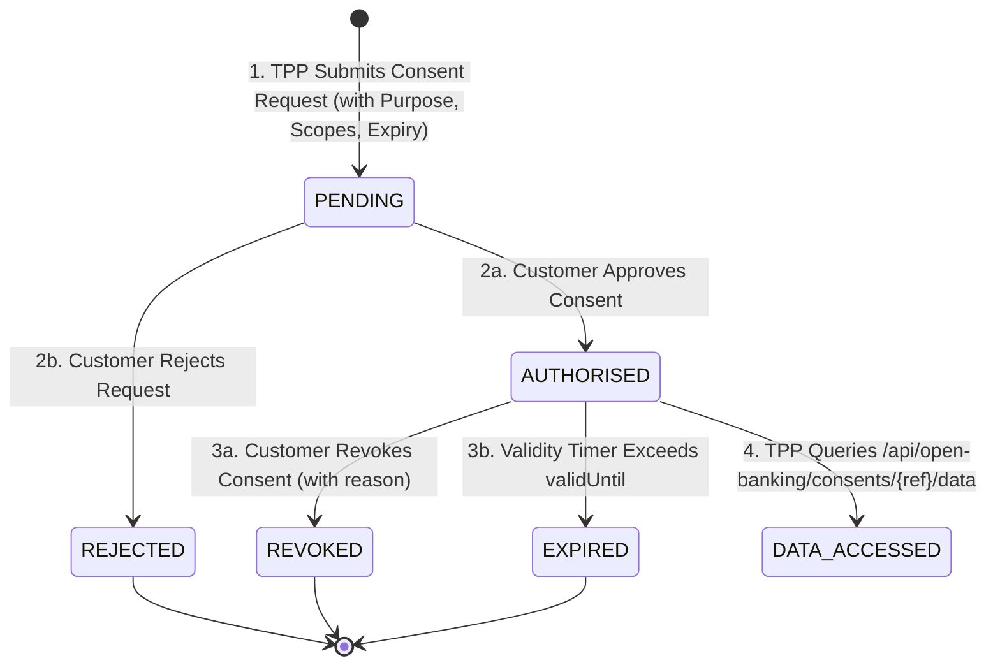

# Open Banking Consent Management, Actors & Role Architecture Guide

## 1. Open Banking Overview & Core Principles
In modern Open Banking frameworks (**UK Open Banking Standard**, **Berlin Group NextGenPSD2**, and **CDR Australia**), a financial institution (**Data Provider**) **never** shares customer financial data or initiates payments on behalf of a Third Party Provider (**Data Consumer / TPP**) without an explicit, time-bounded, scope-restricted, and revocable **Consent** from the **Data Owner (Customer)**.

---

## 2. Core Actors & Authorization Roles

| # | Actor / Role | Description & Primary Capabilities |
|---|---|---|
| 1 | **CUSTOMER / DATA OWNER** (`customer`) | Owns banking accounts & data. Reviews, approves, rejects, and retains the statutory right to **revoke** data sharing consents at any time. |
| 2 | **CONSENT REQUESTER / DATA CONSUMER** (`consent_requester` / `tpp`) | Regulated FinTech / TPP. Submits consent requests defining exact purpose, scopes (`READ_ACCOUNTS`, `READ_BALANCES`, `READ_TRANSACTIONS`), and duration. Queries data only with active consent. |
| 3 | **BANK / DATA PROVIDER** (`bank_provider`) | Maintains account records & transactions. Strictly validates consent status, scope, and validity before releasing financial data. |
| 4 | **CONSENT MANAGER** (`consent_manager`) | State machine engine tracking the full consent lifecycle, evaluating expiration timers, and maintaining immutable audit logs. |
| 5 | **BANKING MAKER** (`maker`) | Initiates banking operations (transfers, payments). Operations &ge; £2,500 automatically route to the Checker approval queue. |
| 6 | **BANKING CHECKER** (`checker`) | Provides dual-authorization by reviewing and approving/rejecting high-value or sensitive operations initiated by Makers. |
| 7 | **SYSTEM ADMINISTRATOR** (`admin`) | Manages users, roles, system health, and inspects audit trails without silently bypassing consent security rules. |

---

## 3. Actor & Role Permission Matrix (RBAC)

| Resource / Action | CUSTOMER | CONSENT_REQUESTER | BANK_PROVIDER | CONSENT_MANAGER | MAKER | CHECKER | ADMIN |
|---|:---:|:---:|:---:|:---:|:---:|:---:|:---:|
| **View Own Accounts & Ledger** | ✅ | ❌ | ✅ (All) | ❌ (Metadata) | ✅ | ✅ | ✅ |
| **Initiate Consent Request** | ❌ | ✅ | ❌ | ❌ | ❌ | ❌ | ❌ |
| **Approve / Reject Consent** | ✅ | ❌ | ❌ | ❌ | ❌ | ❌ | ❌ |
| **Revoke Active Consent** | ✅ | ❌ | ❌ | ❌ | ❌ | ❌ | ❌ |
| **Fetch TPP Financial Data** | ❌ | ✅ (Authorised Only) | ✅ (Validator) | ❌ | ❌ | ❌ | ❌ (Follows Rules) |
| **Initiate Banking Operations** | ✅ | ❌ | ❌ | ❌ | ✅ | ❌ | ✅ |
| **Approve Maker Operations** | ❌ | ❌ | ❌ | ❌ | ❌ | ✅ | ❌ |
| **Inspect Audit Log Trails** | ❌ | ❌ | ❌ | ✅ | ❌ | ❌ | ✅ |

---

## 4. Consent Lifecycle State Machine

### Consent Security Enforcement Rules:
1. **Zero Unauthorized Access**: Data access without a matching valid consent returns `403 Forbidden`.
2. **State Gate**: Only `AUTHORISED` consents allow data sharing. `PENDING`, `REJECTED`, `REVOKED`, and `EXPIRED` are strictly blocked.
3. **Scope Enforced**: If scope is only `READ_ACCOUNTS`, account balances are masked and transaction history is omitted.
4. **Auto-Expiration**: If `validUntil < NOW()`, the engine immediately transitions consent to `EXPIRED` and logs an audit record.
5. **Full Auditability**: Every lifecycle event (`CREATED`, `AUTHORISED`, `REJECTED`, `REVOKED`, `EXPIRED`, `DATA_ACCESS_PERMITTED`, `DATA_ACCESS_DENIED`) is written to `consent_audit_logs`.

---

## 5. Regulated Open Banking Endpoints

### 1. Consent Lifecycle
- `POST /api/consents`: TPP initiates consent request with scopes & purpose.
- `GET /api/consents`: Query all consents.
- `GET /api/consents/customer/{customerId}`: Query customer-specific consents.
- `POST /api/consents/{id}/approve`: Customer authorises the consent.
- `POST /api/consents/{id}/reject`: Customer declines the consent.
- `POST /api/consents/{id}/revoke`: Customer revokes active consent with reason.

### 2. Open Banking Data Access (Data Consumer / Provider)
- `GET /api/open-banking/consents/{consentReference}/data`: Releases authorized accounts, balances, and transactions strictly validated against active consent.

### 3. Maker-Checker Operations
- `POST /api/accounts/{accountId}/transactions`: Maker initiates transaction (flagged `PENDING_APPROVAL` if &ge; £2,500).
- `GET /api/transactions/pending`: Checker views pending approval queue.
- `POST /api/transactions/{id}/approve`: Checker approves operation.
- `POST /api/transactions/{id}/reject`: Checker rejects operation.

### 4. Governance & Audit Trails
- `GET /api/consents/audit`: Full immutable audit trail for Consent Manager & Admin.
- `GET /api/consents/{consentReference}/audit`: Audit history for specific consent.
